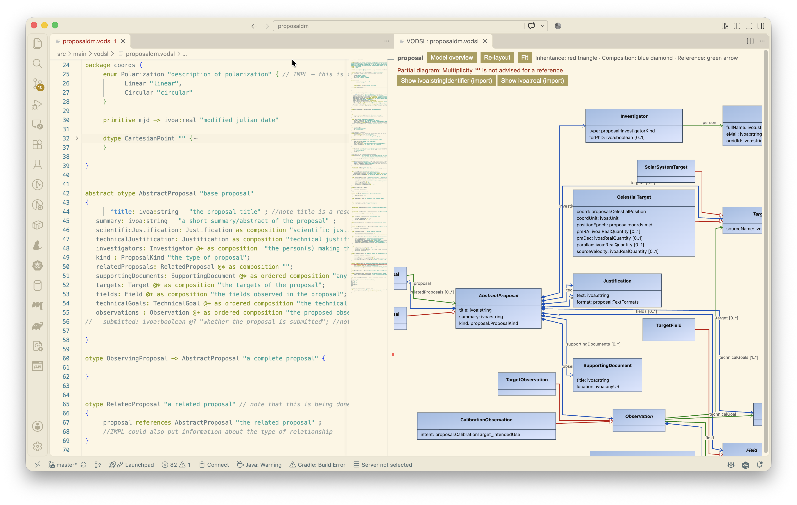

VSCode VODSL editor
===================

There is a VSCode extension for editing VODSL model files. It is available from the [VSCode marketplace](https://marketplace.visualstudio.com/items?itemName=tsastro.vodsl). The extension provides similar functionality to the [Eclipse VODSL editor](EclipseVODSL.md) i.e.

- Compilation of VODSL to VO-DML.

- Real-time validation and syntax checking.

- Navigation via a graphical representation of the model.

